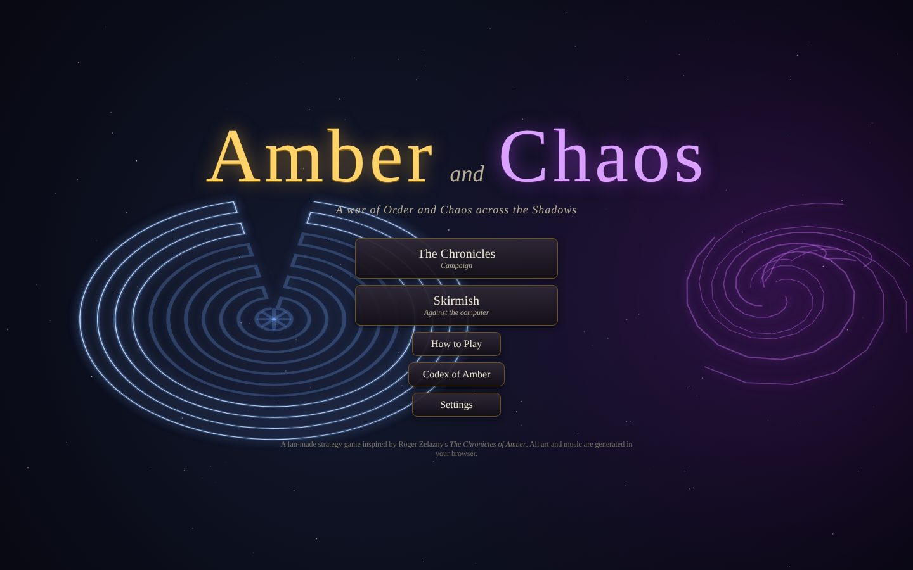
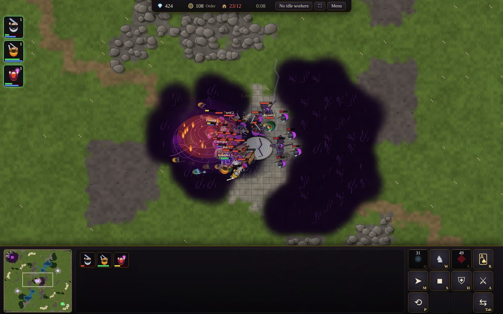
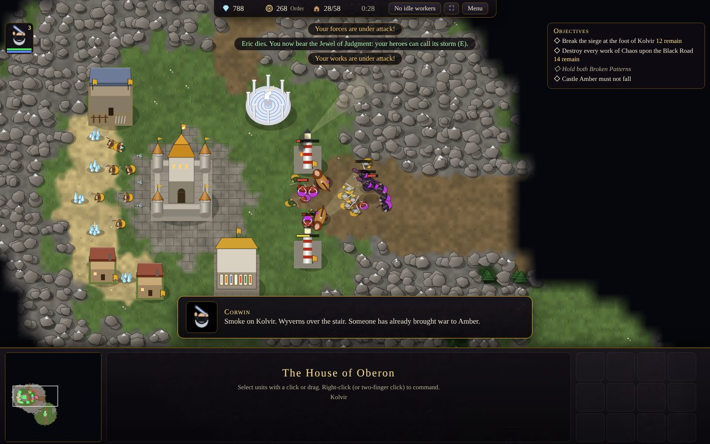
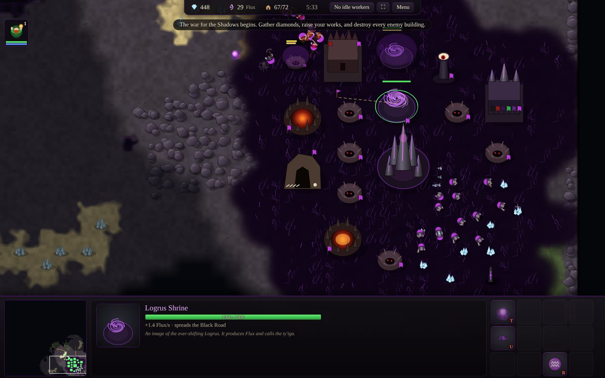

# Amber and Chaos

A real-time strategy game set in Roger Zelazny's *The Chronicles of Amber*. The
House of Oberon and the Courts of Chaos fight across the Shadows. The princes of
Amber answer through their Trumps, the Black Road spreads its life-draining grass
from the Courts, and Broken Patterns hum with stolen power.





## Playing on your Mac

The game is plain HTML5 and JavaScript. It needs no installs, build step or
internet connection, and it runs in Safari, Chrome or Firefox.

1. Get the files, either with `git clone` or by downloading the repository as a ZIP
   and unzipping it.
2. Double-click **`index.html`**. It opens in your default browser.
   You can also double-click **`Play Amber and Chaos.command`**, which does the
   same thing.
3. Click the **⛶** button in the top bar, or press ⌃⌘F in Safari, to play full screen.

If macOS says the `.command` file "cannot be opened", right-click it, choose
**Open**, and confirm. Or just open `index.html` directly.

The game was built for a MacBook (M3 Max, macOS Tahoe 26): Retina rendering,
trackpad gestures and the Mac's built-in Palatino and Didot fonts. Everything
is drawn and synthesised in the browser, including art, terrain, sound effects
and music, so there are no asset files at all.

## Controls

| Action | Trackpad / keyboard |
|---|---|
| Select | Click, or drag a box. Shift-click adds or removes. Double-click selects every unit of that kind on screen. |
| Command (move, attack, gather, build, follow, set rally) | **Two-finger click** or **Control-click**. Hold Shift to queue. |
| Pan | **Two-finger scroll**, arrow keys, the screen edges, or the minimap |
| Zoom | **Pinch**, `+` / `−`, or Option-scroll |
| Attack-move · Move · Stop · Hold · Patrol | `A` · `M` · `S` · `H` · `P` |
| Hero abilities | `Q` `W` `E` `R`. `R` takes the hero home by Trump (Amber) or by the Ways (Chaos). |
| Build (workers) | `B`, then the building's letter |
| Control groups | **Option** (or ⌃ / ⌘) + `1`–`9` sets a group. `1`–`9` selects it; press twice to jump there. |
| Idle worker · whole army · home | `.` (or F1) · `,` (or F2) · Home / ⌫ |
| Next unit kind's abilities | `Tab` |
| Jump to the latest alert | `Space` |
| Pause / cancel | `Esc`, `` ` `` (the key left of 1) or F10. In full screen, Esc leaves full screen and pauses. |

Settings (from the title screen or the pause menu) cover volumes, game speed,
scroll speed, the scroll gesture (two-finger scrolling pans by default; you can make
the wheel always zoom instead), edge scrolling and Retina quality.

## The game

### Two factions that play differently

**Amber**, the one true world of Order:

- Stewards build anywhere, but must stay at a building until it is finished.
- Amber's works hold back the Black Road, and its soldiers slowly heal near them.
- Heroes arrive through the **Hall of Trumps**.
- Research the **Jewel of Judgment** there and any hero can call down its lightning
  storm. The Jewel pays with the bearer's own life force.
- Riflemen fire cartridges packed with Avalonian **jeweler's rouge**, the only
  powder that burns in Amber.

**The Courts of Chaos**:

- Every work must stand on the **Black Road**, which grows outward from Chaos buildings.
- The Road drains the life of enemies who stand on it and heals Chaos soldiers.
- Thralls summon buildings, which then grow on their own.
- The **ty'iga** can possess an enemy soldier.
- A **Wave of Chaos** unmakes whatever it passes over and lays new Road.

### Resources

- **Diamonds** lie loose on the sands of a far Shadow. Corwin paid for his rifles
  with stones like these.
- **Order** (Amber) and **Flux** (Chaos) flow from your seat of power and your
  shrines. Most of all they come from **Broken Patterns**, imperfect copies of the
  Pattern that you claim by holding the ground beside them.

### Heroes

Each hero has two abilities, plus a way home and the faction's great weather-power.
Heroes level up to 6, at most three take the field at once, and the fallen can be revived.

| Amber | | Chaos | |
|---|---|---|---|
| **Corwin** | Image of the Pattern, Ride of Drum. Grayswandir bites deeper into Chaos. | **Dara** | Shape of Chaos, Borel's Lunge |
| **Benedict** | Master of Arms aura, Strategist's Command, Whirlwind of Steel | **Brand** | Living Trump (teleport), Pyrokinesis |
| **Gérard** | Mighty Heave, Hold the Line | **Borel** | Hendrake aura, Riposte, Call of Hendrake |
| **Julian** | Hounds of Arden, The Hunt. Rides through forests on Morgenstern. | **Mandor** | Spheres of Sawall, Machinations |
| **Fiona** | Psychic Binding, Fire of Sorcery | **Jurt** | Logrus Step, Fury |
| **Caine** | Silver Arrow, Feigned Death | **Suhuy** | Logrus Tendrils, Mending of the Logrus |
| **Random** | War Drums, Trump Summons | | |

### Units

| Amber | Chaos |
|---|---|
| Steward of Amber (worker), Guard of Amber, Ranger of Arden, Knight of Avalon, Rouge Rifleman, Hellhound of Arden, Tidecaller of Rebma, Gryphon of Kolvir, Bombard of Avalon | Thrall (worker), Goat-Demon, Crossbowman of the Courts, Hellmaid, Spined Stalker, Manticore, Wyvern Rider, Ty'iga, Abyss Spitter |

There are also wild creatures of Shadow: wolves, feral manticores and the Sphinx.

### The Chronicles (campaign)

1. **The Circle in Lorraine** (*The Guns of Avalon*). Hold Ganelon's keep against the
   demons of the Circle, then slay the goat-faced lord who calls Corwin "opener".
2. **The Guns of Avalon**. Break the siege of Kolvir with the rouge riflemen. Benedict
   comes through a Trump, Eric's death leaves you the Jewel, and Dara walks the Pattern.
3. **The Tower of Brand** (*Sign of the Unicorn*). Corwin, Random and Gérard cross a
   land without a sun to the tower guarded by a glass dragon.
4. **Patternfall** (*The Courts of Chaos*). Benedict's host assaults the Thelbane Spire
   at the edge of the Abyss, while storms of Chaos roll across the field. Corwin and
   Caine join the fight.
5. **Daughter of Chaos** (played as the Courts). Push the Black Road through Arden and
   bring Dara to the Pattern beneath Castle Amber.

Each mission can be played on Easy, Normal or Hard. Normal is meant to be won with
steady play. Hard gives the enemy more troops and a richer economy, and the enemy
strongholds keep garrisons that defend them when attacked.



### Skirmish

Play against 1–3 computer opponents (Easy, Normal or Hard), free-for-all or 2 vs 2, on
five kinds of procedurally generated, symmetric map:

- the Vale of Garnath
- the Forest of Arden
- the Heights of Kolvir
- the Shores of Rebma
- the Edge of the Abyss

You win by destroying every enemy building.



## Lore and sources

The setting was researched on the web rather than written from memory. The
in-game **Codex of Amber** summarises it and lists its sources. The full notes,
with citations and a list of what the game invents, are in
[`docs/LORE.md`](docs/LORE.md). This is an unofficial fan project and is not
affiliated with the Zelazny estate.

## For developers

```
index.html            entry point (classic scripts, so it runs from file://)
css/style.css
js/core/              simulation, with no DOM, so it also runs under Node
  util data map path game behavior abilities commands ai setup scenarios
js/ui/                presentation
  art render audio hud input menus main
tests/                headless and browser tests
docs/                 lore notes and screenshots
```

Tests need Node 18+, and Playwright for the browser tests:

```
node tests/sim_test.js 25            # one AI-vs-AI skirmish, with a timeline
node tests/winrate.js 10             # faction balance over 10 games
node tests/balance_test.js mixed     # equal-cost army duels
node tests/scenario_test.js 6        # every campaign mission runs without errors
node tests/scenario_ai_test.js       # the computer plays the human side, to check missions can be won
node tests/browser_test.js           # Chromium: menus, input, every mission; fails on any page error
node tests/docs_screenshots.js       # regenerates the README screenshots
```
